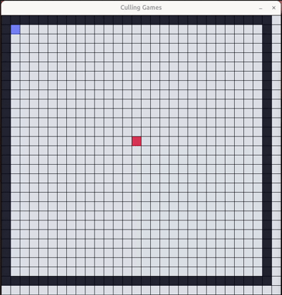
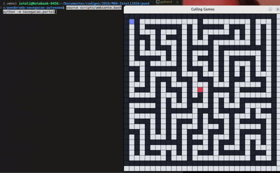
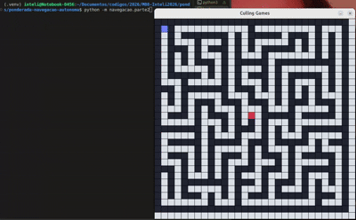

# Atividade ponderada — Navegação autônoma

O objetivo desta ponderada é aplicar algoritmos de grafos para fazer um robô encontrar o caminho até um alvo em um labirinto. O projeto usa Python e um simulador em pygame, com comunicação pelo ROS 2.

A atividade tem duas partes:

1. **Navegação com mapa:** o robô tem acesso ao labirinto completo e deve encontrar uma rota otimizada até o alvo.
2. **Mapeamento do labirinto:** o robô deve explorar o ambiente e construir um mapa durante a navegação. Depois, é preciso demonstrar que esse mapa permite reproduzir a rota da primeira parte.

As duas partes estão implementadas e foram verificadas no simulador.

## Simulador

Foi utilizado o [Culling Games](https://github.com/rmnicola/culling_games), indicado no enunciado. O labirinto é uma matriz em que cada célula representa uma posição do ambiente:

| Cor | Elemento | Símbolo no mapa |
| --- | --- | --- |
| Azul | Robô | `r` |
| Vermelho | Alvo | `t` |
| Branco | Espaço livre | `f` |
| Preto | Parede | `b` |

O robô pode se mover para cima, para baixo, para a esquerda e para a direita. Os comandos são enviados por serviços ROS.

O código original está na pasta [`simulador/`](simulador/), com a licença MIT preservada. A referência ao repositório e ao commit utilizado está em [`simulador/ORIGEM.md`](simulador/ORIGEM.md). A solução da atividade fica separada, na pasta [`navegacao/`](navegacao/).

Foi acrescentado um limite de 60 FPS à renderização para evitar que a janela consumisse CPU continuamente. Essa alteração está registrada em `simulador/ORIGEM.md`; os serviços, os sensores e as regras de movimento foram mantidos.

## Preparação do ambiente

O ambiente utilizado foi Ubuntu 24.04, Python 3.12 e ROS 2 Jazzy, com `colcon` instalado. A comunicação foi testada com Cyclone DDS. Caso ele não esteja instalado em outro ambiente Jazzy:

```bash
sudo apt install ros-jazzy-rmw-cyclonedds-cpp
```

Na raiz do repositório, crie o ambiente Python, instale as dependências e compile os pacotes do simulador:

```bash
python3 -m venv --system-site-packages .venv
.venv/bin/python -m pip install -r requirements.txt
source scripts/ambiente.bash
cd simulador
colcon build --symlink-install
cd ..
source scripts/ambiente.bash
```

O arquivo `scripts/ambiente.bash` carrega o ROS, o ambiente Python e os pacotes compilados. Ele deve ser carregado em cada terminal usado para executar o projeto. Também seleciona Cyclone DDS por padrão, pois houve perdas intermitentes de respostas nos testes com a configuração anterior.


## Parte 1 — Encontrando o menor caminho

A solução começa consultando o serviço `/get_map`, que retorna o mapa completo. Com esses dados, o programa monta a matriz e identifica as posições do robô, do alvo e das paredes. As coordenadas seguem a ordem `(linha, coluna)`.

Para calcular a rota, foi utilizada a **busca em largura (BFS)**. Cada célula livre funciona como um vértice do grafo, e cada movimento permitido entre células vizinhas funciona como uma aresta. Como todos os movimentos custam um passo, a BFS encontra um caminho com o menor número de movimentos.

A busca usa uma fila: primeiro verifica as posições a um passo do início, depois as posições a dois passos, e assim por diante. As células visitadas são registradas para evitar repetições. O programa também guarda de qual célula chegou a cada posição, permitindo reconstruir o caminho quando encontra o alvo.

Depois do planejamento, a rota é convertida em comandos enviados ao serviço `/move_command`. O programa confere a posição retornada após cada movimento e salva um relatório com a rota planejada e o que foi executado. 

Os arquivos principais são:

- [`navegacao/busca.py`](navegacao/busca.py): busca em largura e conversão da rota em movimentos.
- [`navegacao/parte1.py`](navegacao/parte1.py): leitura do mapa, comunicação com o simulador e execução da rota.

### Resultados

A navegação foi testada com o simulador em três mapas:

| Mapa | Movimentos planejados | Movimentos executados | Resultado |
| --- | ---: | ---: | --- |
| `test.csv` | 25 | 25 | Alvo alcançado |
| `1.csv` | 102 | 102 | Alvo alcançado |
| `2.csv` | 102 | 102 | Alvo alcançado |

As rotas também foram comparadas com uma implementação independente de Dijkstra para conferir o custo mínimo. Dijkstra foi usado apenas nessa verificação; o algoritmo de navegação é a BFS.

Os relatórios estão na pasta [`resultados/`](resultados/). Eles contêm o mapa inicial, a rota, os comandos, a quantidade de movimentos e a posição final. Os testes de integração foram executados com o simulador sem janela, em domínios ROS separados.

### Demonstração

Primeiro teste no labirinto `test.csv`, com uma rota de 25 movimentos:



Execução no labirinto `1.csv`, com uma rota de 102 movimentos. Este é o mesmo labirinto usado na demonstração da parte 2, permitindo comparar as rotas finais:



### Como executar

#### Abrir o labirinto

Em um terminal na raiz do repositório:

```bash
source scripts/ambiente.bash
ros2 run cg maze -- --map 1.csv
```

#### Executar a rota

Com o simulador aberto, use outro terminal na raiz do repositório:

```bash
source scripts/ambiente.bash
python -m navegacao.parte1
```

O robô deve percorrer a rota até o alvo. Para apenas calcular a rota, sem movimentá-lo:

```bash
python -m navegacao.parte1 --planejar
```

O resultado é salvo em `resultados/parte1.json`. Para repetir a execução desde o início, reinicie o mapa e aguarde o robô voltar à posição inicial:

```bash
ros2 service call /reset cg_interfaces/srv/Reset "{is_random: false}"
```

Mantenha apenas um simulador ativo no mesmo domínio ROS e não envie comandos manuais durante a navegação automática. Se o simulador já estava aberto antes de atualizar a configuração do projeto, encerre com `Ctrl+C` e abra novamente após carregar `scripts/ambiente.bash`.

### Testes

Os dez testes da parte 1 cobrem a busca e a confirmação dos movimentos, incluindo desvio de paredes, alvo inacessível e posição diferente da esperada. O comando abaixo executa todos os testes do projeto, incluindo os da parte 2:

```bash
source scripts/ambiente.bash
python -m unittest discover -s tests -v
```

Para repetir a navegação nos três mapas e a comparação com Dijkstra:

```bash
python scripts/verificar_parte1_ros.py
```

Se uma resposta de movimento não chegar em dez segundos, o cliente não repete o comando, pois o robô pode já ter se movido. Na parte 1, ele consulta o mapa para confirmar a posição esperada antes de continuar. Se não conseguir confirmar, interrompe a execução. Os testes finais com Cyclone DDS concluíram os três mapas sem precisar dessa recuperação.


## Parte 2 — Construindo o mapa

O simulador conhece o labirinto para desenhar a janela e controlar as colisões. A janela mostra o ambiente inteiro para quem está acompanhando, mas isso não significa que o algoritmo tenha acesso a todas essas informações. Na parte 1, o programa recebe o mapa completo; na parte 2, constrói seu próprio mapa a partir das observações locais.

Nesta parte, o robô começa sem conhecer o labirinto. Ele lê o tópico `/culling_games/robot_sensors`, que informa as oito células ao redor, e registra as observações em um mapa. O programa não consulta `/get_map`, não lê os arquivos CSV do labirinto e não utiliza o campo `target_pos` retornado pelo serviço de movimento. O alvo é descoberto pelos sensores.

### Exploração e planejamento

A exploração usa **busca em profundidade (DFS)**. O robô avança para uma célula livre ainda não visitada e guarda o caminho em uma pilha. Quando não há outra célula para explorar, volta à posição anterior e tenta os caminhos que ficaram pendentes. Assim, consegue lidar com becos e ciclos sem ficar repetindo a mesma exploração.

A posição inicial é tratada como `(0, 0)`, e as demais posições são registradas em relação a ela. As células ainda desconhecidas aparecem como `?` no mapa salvo. Elas não são consideradas livres durante o planejamento. Nesse mapa, `r` marca a origem da execução, e a posição atual é registrada separadamente no relatório.

O alvo fica para o final, pois entrar nele encerra o jogo. O robô explora a região acessível sem atravessá-lo, retorna ao início e aplica a mesma BFS da parte 1 ao mapa que construiu. Depois, percorre a rota calculada até o alvo.

Não é necessário conhecer as regiões que só poderiam ser acessadas depois de atravessar o alvo para encontrar uma rota até ele. A verificação é se o mapa obtido contém as informações necessárias para reproduzir a rota da parte 1.

**DFS e BFS têm funções diferentes aqui:** a DFS organiza a exploração; a BFS encontra a menor rota final. Os movimentos gastos explorando e voltando não fazem parte do custo dessa rota.

Os arquivos principais são:

- [`navegacao/mapeamento.py`](navegacao/mapeamento.py): mapa das observações e exploração com DFS.
- [`navegacao/parte2.py`](navegacao/parte2.py): sensores, movimentos, retorno ao início e execução da rota final.
- [`navegacao/validacao.py`](navegacao/validacao.py): comparação dos relatórios das duas partes, feita depois da navegação.

### Resultados

Foram testados dois mapas pequenos de apoio e o mapa `1.csv` do simulador:

| Mapa | Movimentos de exploração | Rota final | Comparação com a parte 1 |
| --- | ---: | ---: | --- |
| `exploracao.csv` | 50 | 7 movimentos | Mesma rota e mesmo custo |
| `alvo_passagem.csv` | 14 | 2 movimentos | Mesma rota e mesmo custo |
| `1.csv` | 780 | 102 movimentos | Mesma rota e mesmo custo |

Os relatórios e as comparações estão em [`resultados/parte2/`](resultados/parte2/). A verificação confere as células observadas com o mapa de referência, verifica se a rota da parte 1 está disponível no mapa construído e compara a sequência de posições e o custo da rota executada.

No mapa `1.csv`, a parte 1 encontra uma rota de 102 movimentos usando o mapa completo. A parte 2 primeiro gasta 780 movimentos explorando e voltando ao início; depois percorre a mesma rota final de 102 movimentos usando o mapa que construiu. A comparação confere cada posição da rota, além da quantidade de passos. O resultado está em [`resultados/parte2/mapa1/comparacao.json`](resultados/parte2/mapa1/comparacao.json).

Esse resultado comprova, nas execuções registradas, que o mapa construído pelos sensores foi suficiente para reproduzir a rota da primeira parte. A verificação aprovou a consistência das células observadas, a presença da rota no mapa construído, a igualdade da sequência de posições e do custo, além da conclusão dos movimentos.

Os comandos de execução das duas partes usam o mesmo mapa `1.csv` e a mesma posição inicial. Reinicie o labirinto entre as execuções para comparar as rotas. Tanto `test.csv` quanto `1.csv` vieram do repositório original do simulador. Os dois mapas em `tests/mapas/` foram criados apenas para testes adicionais.

Os mapas de apoio ficam em [`tests/mapas/`](tests/mapas/). O primeiro contém ciclos e caminhos alternativos. O segundo tem uma região atrás do alvo, para verificar que ela pode continuar desconhecida sem impedir a reprodução da rota.

### Demonstração

Exploração do labirinto, retorno ao ponto inicial e execução da rota calculada a partir do mapa construído.



### Como executar

Feche o simulador anterior com `Ctrl+C`. Para repetir o teste no mapa `1.csv`, abra um terminal na raiz do repositório:

```bash
source scripts/ambiente.bash
ros2 run cg maze -- --map 1.csv
```

Em outro terminal, também na raiz:

```bash
source scripts/ambiente.bash
python -m navegacao.parte2
```

O robô vai explorar, voltar ao ponto inicial e seguir a rota calculada até o alvo. O relatório será salvo em `resultados/parte2.json`. Para acelerar a execução, é possível reduzir a pausa entre movimentos:

```bash
python -m navegacao.parte2 --intervalo 0
```

A exploração é mais longa que a navegação da parte 1, porque inclui os caminhos percorridos para descobrir o ambiente e voltar. Não use teleoperação durante esse processo. Para repetir, reinicie o mapa antes de executar o programa novamente.

### Comparação com a parte 1

Após executar no mapa `1.csv`, compare com o relatório correspondente da parte 1:

```bash
python -m navegacao.validacao \
  --parte1 resultados/parte1_mapa_1.json \
  --parte2 resultados/parte2.json
```

A comparação exige o mesmo labirinto e a mesma posição inicial nas duas execuções. As coordenadas relativas da parte 2 são convertidas para as coordenadas do simulador usando o deslocamento identificado pelo retorno dos movimentos. O arquivo de referência só é lido pelo verificador, depois que a parte 2 terminou.

### Testes

Os oito testes de mapeamento cobrem ciclos, becos, alvo inacessível, coordenadas relativas e comparação com a parte 1. Um deles faz essa comparação em 50 mapas aleatórios com uma semente fixa. Somados aos testes anteriores, são 18 testes automatizados:

```bash
source scripts/ambiente.bash
python -m unittest discover -s tests -v
```

Para repetir os testes de integração e salvar as comparações dos três mapas:

```bash
python scripts/verificar_parte2_ros.py
```

Esse verificador executa o simulador sem janela em domínios ROS separados. Durante a parte 2, ele bloqueia a criação de um cliente para `/get_map` e a abertura de arquivos CSV. A comparação com o mapa completo acontece apenas no processo do verificador.

Se uma resposta de movimento não chegar a tempo, a parte 2 interrompe a execução sem repetir o comando e sem consultar o mapa completo. Nesse caso, reinicie o labirinto antes de tentar novamente.
